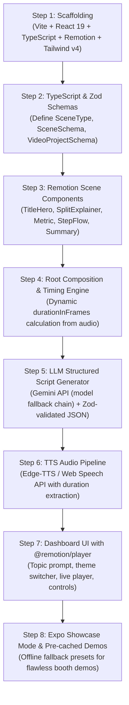

# 🎬 VidyaMotion AI (Topic-to-Video Engine) — Master Project Specification & AI Builder Prompt

> **Project Identity:** VidyaMotion AI — Autonomous Topic-to-Animated-Video Generation Studio  
> **Target Event:** Tech Expo 2027 – *Innovating for Bharat @ 2047*, Parul University  
> **Track:** `Digital India & Smart Technologies`  
> **Core Stack:** React 19 / TypeScript / Vite / Tailwind CSS / Remotion (`@remotion/player`, `@remotion/captions`) / Gemini API (3.8 Flash with model fallback chain) / Edge-TTS  
> **Output Location:** `Topic2video` (project root)

---

## 📋 System Instruction / Master Builder Prompt

*Copy and paste the prompt block below into any AI coding assistant (Antigravity, Claude, Cursor) to scaffold and build this entire project from scratch.*

```markdown
You are an expert Principal Full-Stack Engineer and Remotion specialist. Your mission is to build "VidyaMotion AI", a production-ready, client-side-first Web Application that takes any educational, scientific, or conceptual topic prompt (in English, Hindi, or Gujarati) and autonomously generates a high-definition, 60 FPS animated explainer video with kinetic typography, synchronized voiceover narration, animated SVG/Lucide visual diagrams, and TikTok/Reels-style karaoke subtitles, playable instantly in the browser using the Remotion Player.

### 0. Agent Execution Strategy (/swarm)
- This build is launched by the user with the **`/swarm` command** and this file attached, so **this conversation is the swarm coordinator**. Your job is to split the work, brief the workers, judge what comes back, and report to the user.
- **You decide how many workers to create**, based on how many you can brief precisely and supervise reliably. The deciding factor is a **low hallucination / error rate**: never create more workers than you can supervise accurately, and if in doubt, use fewer.
- **Split the work into pieces that don't collide.** Each worker owns specific files or folders, and a file has only one owner at a time. Every worker's public brief must say what it owns, what it must not touch, and what "done" means.
- **Foundation first, then parallel work.** The project scaffold, dependencies and the shared data contracts (Section 3 Zod schemas/types) must be completed and verified before parallel work starts. Workers treat them as the single source of truth and ask you before changing them.
- **Always add a `@verifier`.** It reads the diffs, runs the type-check, build and tests, runs the acceptance tests defined in this spec (Sections 5, 7.1 and 9), and reports problems back to the worker that wrote the code, which then fixes them. If a different model is available in the model picker, the verifier may run on a different model than the workers. The project is not done until the verifier passes.
- If you give workers separate working copies of the repository, each worker must land its changes before it is removed, because removing a worker deletes its working copy.
- Correctness and consistency across the whole project matter more than speed.

---

### 1. Key Architectural Guarantees & Constraints
1. **AI Code Mode (SUPERSEDES Static Template Guarantee):** Rather than restricting visuals to a fixed set of static templates, VidyaMotion AI uses **AI Code Mode**, where Gemini dynamically writes self-contained Remotion TSX scene code tailored specifically to each topic (animated SVG diagrams, step flows, charts, chemical/math formulas). The client browser compiles the TSX code at runtime using `sucrase` and executes it within a secure, ErrorBoundary-protected runner inside `@remotion/player`. Reliability is guaranteed via pre-run static AST/regex scanning, up to 2 self-correction attempts, model fallback chaining, and a graceful placeholder card fallback ensuring the video never crashes or stops playback.
2. **Instant Playback & In-Browser Export (Approach 2):** 
   - The user MUST NOT wait 3 minutes for server-side FFmpeg rendering. The generated video starts playing in the browser as scenes stream in using `@remotion/player`.
   - For downloads, implement **Approach 2: In-Browser Client-Side Video Export** using Remotion's client-side renderer (`@remotion/web-renderer`, WebCodecs-based; see Section 7.1). This completely eliminates server-side Chromium/FFmpeg compute, avoids all Vercel 10-second serverless timeouts, and generates downloadable video files directly on the client machine with zero server CPU cost (the exact output format is determined in Section 7.1).
3. **Mathematically Locked Audio Sync:** Scene durations must NOT be arbitrarily hardcoded. Each scene's frame duration must be calculated directly from the duration of its synthesized audio track:
   `durationInFrames = Math.ceil(audioDurationInSeconds * 30)` at 30 FPS. Generated scene code is duration-agnostic and times animations relative to `durationInFrames`.
4. **Defensive UI & Text Clamping:** All typography inside Remotion scenes must use flexible layouts (`line-clamp-2`, auto-wrapping, dynamic font scaling) so long titles or bullet points never clip outside the 1080p canvas.
5. **Expo-Proof Offline Cache:** Include a pre-warmed offline showcase cache containing 4 complete, verified topic compositions (e.g., "Binary Search Trees", "Photosynthesis in Hindi", "How Rocket Engines Work", "Ohm's Law in Gujarati") generated in Code Mode so the application can be demonstrated flawlessly even if the Tech Expo Wi-Fi drops.

---

### 2. Technology Stack & Packages
- **Frontend Framework:** React 19 + TypeScript + Vite
- **Video Engine:** Remotion 4.x (`remotion`, `@remotion/player`, `@remotion/captions`, `@remotion/media-utils`, `@remotion/media`, `@remotion/web-renderer`)
- **Styling & UI:** Tailwind CSS v4 + Lucide React icons + Framer Motion (for dashboard UI)
- **AI & Validation:** the Gemini API on the free tier (official Google SDK or REST, verified in Section 5), with an automatic model fallback chain starting from Gemini 3.8 Flash + `zod` (Zod validation + automatic retry is the guarantee of valid JSON)
- **Voice & TTS Engine:** Microsoft Edge-TTS (`msedge-tts` in Node or `edge-tts` CLI)
  - **100% Free** (No API keys or credit card needed)
  - Native Neural Indian Accents:
    - **English (India):** `en-IN-NeerjaNeural` (Female) / `en-IN-PrabhatNeural` (Male)
    - **Hindi (India):** `hi-IN-SwaraNeural` (Female) / `hi-IN-MadhurNeural` (Male)
    - **Gujarati (India):** `gu-IN-DhwaniNeural` (Female) / `gu-IN-NiranjanNeural` (Male)
  - Word-level timestamp boundaries (`{ word, start, end }`) directly feeding Remotion karaoke subtitles
- **Backend / API Layer:** Node.js (Express / Fastify) for TTS audio synthesis and Remotion SSR rendering
  - ⚠️ **Agent must resolve before scaffolding (do not guess):** This line (Express/Fastify + Remotion SSR) conflicts with Section 2.2 (Vercel serverless functions in `/api`) and with the no-server-rendering requirement in Section 1. Research using multiple trusted sources (official Vercel, Remotion and `msedge-tts` documentation, plus recent GitHub issues) to determine which backend setup actually works for this project, including whether `msedge-tts` runs reliably inside a Vercel serverless function. State your decision and reasoning, then keep the entire codebase consistent with it.
- **State Management:** React Context or Zustand with localStorage persistence for saved videos

---

### 2.1. Why This Tech Stack Beats All Alternatives
| Competitor / Alternative | Why Our Stack (Vite + Remotion + Gemini 3.8 Flash + Edge-TTS) Wins |
| :--- | :--- |
| **Next.js (App Router)** | Remotion heavily depends on client-only APIs (`window`, `canvas`, Web Audio, `requestAnimationFrame`). Next.js SSR causes frequent hydration mismatches (`window is not defined`) requiring cumbersome dynamic imports and `"use client"` wrappers. **Vite is 100% client-native, offers sub-50ms HMR for spring animation tweaking, and deploys as a single repo on Vercel with serverless functions in `/api`**. |
| **Python (Manim / MoviePy)** | Manim takes 1–3 minutes to compile an MP4 via FFmpeg and has no in-browser player. Remotion's `@remotion/player` previews videos in 3 seconds inside the browser DOM. CSS Flexbox prevents text overflow bugs that plague Manim coordinate math. |
| **ElevenLabs TTS** | ElevenLabs charges high per-character fees and has strict monthly caps. Edge-TTS is completely free, has no character limits, and provides native Hindi, Gujarati, and Indian English neural voices. |
| **OpenAI GPT-4o** | The Gemini API free tier costs nothing to run, and an automatic multi-model fallback chain plus Zod validation + retry keeps script generation reliable and schema-valid. |

---

### 2.2. Vercel Single-Repository Architecture (Vite + Serverless Functions)
The entire project deploys to Vercel as a single repository without needing separate backend hosting:
```text
Topic2video/
├── api/                           # Vercel Serverless Functions (Backend)
│   ├── generate-script.ts         # Stage 1: Gemini API structured script plan + visual briefs
│   ├── generate-scene-code.ts     # Stage 2: Gemini API dynamic Remotion TSX code generator
│   └── generate-speech.ts         # msedge-tts audio synthesis & word timestamp extraction
│
├── src/                           # Vite SPA Frontend (Client-side)
│   ├── remotion/                  # Compositions, scenes, and dynamic code runner
│   │   ├── components/            # DynamicSceneRunner, KaraokeCaptionsOverlay, SceneBackground
│   │   ├── reference/templates/   # Static reference templates (few-shot exemplars)
│   │   ├── Root.tsx               # Root Remotion Composition definition
│   │   └── types.ts               # Shared Zod & TypeScript interfaces (Code Mode schemas)
│   ├── components/                # UI Dashboard, @remotion/player, Controls, Code Viewer
│   ├── hooks/                     # useVideoExport, useVideoProject
│   ├── App.tsx                    # Main Layout & Studio view
│   └── main.tsx
│
├── package.json
├── vite.config.ts
└── vercel.json                    # Routing rewrite rules
```

---

### 3. Core Data Contracts & Zod Schemas

```typescript
// types/videoSchema.ts
import { z } from "zod";

export const SceneTypeSchema = z.enum([
  "TITLE_HERO",           // Bold kinetic typography, glowing gradient, topic intro
  "SPLIT_EXPLAINER",       // Left: animated SVG/Lucide concept graphic; Right: structured bullet points
  "KEY_METRIC_OR_FACT",    // Big animated statistical callout / formula / highlighted definition
  "STEP_BY_STEP_FLOW",     // 3-step sequential timeline with spring animations
  "SUMMARY_TAKEAWAY"       // Key recap points with dynamic badge checklist
]);

export const SceneSchema = z.object({
  id: z.string(),
  type: SceneTypeSchema,
  heading: z.string().max(80),
  subtext: z.string().max(160).optional(),
  bulletPoints: z.array(z.string().max(100)).max(4).optional(),
  highlightWord: z.string().max(30).optional(),
  iconName: z.string().default("Sparkles"), // Lucide icon identifier
  narrationScript: z.string(),              // Exact text sent to TTS engine
  accentColor: z.string().default("#06B6D4"), // Neon cyan, amber, emerald, or violet
  durationInFrames: z.number().default(150),  // Dynamically computed from audio length
  audioUrl: z.string().optional()
});

export const VideoProjectSchema = z.object({
  id: z.string(),
  topic: z.string(),
  language: z.enum(["en-IN", "hi-IN", "gu-IN", "en-US"]).default("en-IN"),
  theme: z.enum(["cyber_dark", "clean_modern", "sunset_amber", "emerald_nature"]).default("cyber_dark"),
  aspectRatio: z.enum(["16:9", "9:16"]).default("16:9"), // Landscape for lectures, Portrait for Shorts
  fps: z.literal(30),
  scenes: z.array(SceneSchema).min(3).max(6),
  totalDurationInFrames: z.number()
});

export type Scene = z.infer<typeof SceneSchema>;
export type VideoProject = z.infer<typeof VideoProjectSchema>;
```

---

### 4. AI Code Mode: Dynamic Scene Architecture & Design Guidelines

In VidyaMotion AI, Remotion scene components are **not** restricted to static hardcoded templates. Instead, the Gemini API dynamically writes full, self-contained Remotion TSX code for each scene based on the topic and visual brief (animated SVG diagrams, step flows, charts, chemical/math formulas).

#### 4.1. Runtime Dynamic Scene Execution (`DynamicSceneRunner.tsx`)
- **Compilation:** Uses in-browser `sucrase` (`{ transforms: ["jsx", "typescript"], jsxRuntime: "classic" }`) to transform LLM-written TSX into `React.createElement` code in under 5ms.
- **Sandboxing & Scope Injection:**
  - Evaluated in a controlled factory function:
    `const factory = new Function("React", "Remotion", "Lucide", "tokens", "props", code);`
  - Injected dependencies: React hooks, Remotion primitives (`useCurrentFrame`, `useVideoConfig`, `interpolate`, `spring`, `AbsoluteFill`, `Sequence`), Lucide icon library (`Lucide.*`), and theme tokens.
  - Globals shadowed: `window = undefined`, `document = undefined`, `globalThis = undefined`, `fetch = undefined`, `eval = undefined`.
  - Static AST/regex security validator blocks any attempt to use `fetch`, `localStorage`, `process`, or dynamic `import`.
  - Infinite loop guard: system prompt forbids unbounded loops; static validator checks for `while(true)` and unbounded iteration.
- **Error Containment & Fallbacks:**
  - Wrapped in a React `ErrorBoundary`.
  - On compile or runtime error: the pipeline triggers up to 2 self-correction attempts sent back to the model with the exact compiler/runtime error message.
  - If corrections and fallback models fail, renders a graceful placeholder card (scene heading over theme background with voiceover and karaoke subtitles playing uninterrupted).

#### 4.2. Output Quality & Design Guide
- **1080p Canvas & Safe Zones:** 1920x1080 (16:9 Landscape) or 1080x1920 (9:16 Portrait). Safe margins of 64px on sides and 160px from the bottom to prevent clipping by karaoke subtitles.
- **Duration-Agnostic Timing:** Scenes receive `{ frame, fps, durationInFrames, themeTokens, captions }`. All entrance and exit transitions scale relative to `durationInFrames` so animations look natural whether the voiceover lasts 4 seconds or 12 seconds.
- **Typography & Font Stacks:** Bundled local fonts (`Inter` for English, `Noto Sans Devanagari` for Hindi, `Noto Sans Gujarati` for Gujarati). Minimum font size 28px for subtext, 48px for headings.
- **Topic-Specific Visuals:** System prompt requires rich, topic-specific visuals: animated SVG diagrams with labeled parts, process step flows with animated connectors, interactive charts, or formula cards.
- **Reference Template Exemplars:** Original static scene components (`TitleHero`, `SplitExplainer`, `KeyMetric`, `StepFlow`, `SummaryTakeaway`) are archived in `src/remotion/reference/templates/` and their code patterns are supplied as few-shot training examples in the Stage 2 system prompt.
- **Web-Renderer Compatibility:** Only features that cleanly rasterize to canvas in `@remotion/web-renderer` are allowed: pure inline `#hex`/`rgba()` colors, SVG elements, standard Flexbox/Grid, and `spring`/`interpolate` animation. No `conic-gradient`, no `backdrop-filter`, no CSS `@keyframes`, and no 4-argument box shadows.

#### 4.3. `<KaraokeCaptionsOverlay />`
- Preserves word-level timestamp synchronicity from Edge-TTS using `@remotion/captions`. Highlights the current active spoken word with a bright neon yellow background pill and solid background container.

---

### 5. Gemini API Structured Prompting Engine

The backend API route (`/api/generate-script`) must call the Gemini API with structured JSON enforcement, validate the result with Zod, and retry on invalid output:

```typescript
// System instruction for the LLM
const SYSTEM_PROMPT = `
You are the Script Director for "VidyaMotion AI", an educational video generation studio.
Given a topic, target language, and audience, break down the concept into 3 to 6 engaging, bite-sized visual scenes.

RULES:
1. Each scene MUST have an engaging 'narrationScript' that sounds conversational and human.
2. Choose the appropriate 'type' for each scene (TITLE_HERO for opening, SPLIT_EXPLAINER for details, STEP_BY_STEP_FLOW for sequences, SUMMARY_TAKEAWAY for recap).
3. Select appropriate Lucide icon names (e.g., 'Brain', 'Cpu', 'Atom', 'Leaf', 'Zap', 'Database', 'Shield').
4. The narration MUST match the selected language (English, Hindi transliterated or Devanagari, or Gujarati).
5. Output MUST strictly match the provided VideoProject JSON schema with zero extra markdown formatting.
`;
```

**Gemini API integration:**
- Use the current official Gemini API (documentation at ai.google.dev) through Google's official SDK (currently expected: `@google/genai`; confirm) or REST. Authenticate with the API key from a server-side environment variable only (`GEMINI_API_KEY`, read inside the `/api` function); it must never reach the client bundle.
- The model list comes from the environment variable `GEMINI_MODELS` (comma-separated, ordered from best to last resort). If the variable is missing, use this same list as the code's default. The order was chosen from benchmark rankings and from the free-tier limits shown for the user's key in Google AI Studio:
  1. `gemini-3.8-flash` (strongest; small daily allowance)
  2. `gemini-3.6-flash` (small daily allowance)
  3. `gemini-3-flash-preview` (small daily allowance)
  4. `gemini-3.5-flash-lite` (weaker, much larger daily allowance)
  5. `gemini-3.1-flash-lite` (slightly weaker, much larger daily allowance)
  6. `gemma-4-31b-it` (weakest, very large allowance; last resort)
- Do NOT add `gemini-3.7-flash`, `gemini-3.5-flash` or `gemini-flash-latest`: they are aliases that run as 3.8 / 3.6 and share their limits, so they add nothing.

**Model and key fallback logic (in one small helper used by `/api/generate-script`):**
- Try the models in order. For each model, try the API keys in order (`GEMINI_API_KEY`, then `GEMINI_API_KEY_BACKUP_1`, `_2`, ...). Use the best model on all keys before dropping to the next model.
- Move on to the next key or model on: HTTP 429 (limit reached), 503 / 500 / 504 (overloaded or server error), 404 (model no longer available) and timeouts.
- On 401 / 403 (invalid or revoked key), skip that key for the rest of the request.
- On 400, do not rotate blindly. If the cause is a feature a particular model does not support (for example JSON mode or system instructions on `gemma-4-31b-it`), send a request format that model supports instead of failing.
- If the response fails Zod validation, retry once with the same model, then move to the next model.
- Keep the whole chain within the serverless function time limit: choose per-call timeouts so that falling through several models does not exceed it.
- Return and log (never with keys) which model produced the script. Each request starts again from the first model; serverless functions keep no memory between requests, and no database may be added for this.
- If every model and key fails, show one clear error in the UI and offer the pre-cached Expo demo topics (Section 1, point 5) so the booth never shows a blank screen.

**Backup API keys:**
- Keys are provided ONLY through server-side environment variables: `GEMINI_API_KEY` (primary) plus `GEMINI_API_KEY_BACKUP_1`, `GEMINI_API_KEY_BACKUP_2`, and so on (support any number of backups). Skip any that are empty or missing.
- Never expose keys to the browser: do not use `VITE_`-prefixed variables, never send keys in API responses or error messages, and never log them in full (at most the last 4 characters).
- Gemini API rate limits are applied per Google Cloud project, not per key, so a backup key from the same project shares the same limits (verify in the official rate-limits documentation). Backup keys mainly help when they belong to a different project.
- Add placeholder-only entries for all these variables to a `.env.example` file, make sure `.env` is in `.gitignore`, and document that the same variable names must be set in the Vercel project settings.

**The agent MUST verify these itself (do not guess; cross-check the official Gemini docs plus other trusted, recent sources, and test with real calls using the user's key):**
1. The correct current SDK package and request format, including structured JSON output (response schema / JSON mode) and system-instruction support for EACH model in the chain. In particular check `gemma-4-31b-it`: if it does not support these, put the instructions in the user message and rely on Zod validation + retry.
2. That every model in the list actually responds with the user's key, and the real limits shown at aistudio.google.com/rate-limit. If a model is rejected, report it to the user instead of silently changing the order.
3. Whether the models return reasoning/"thinking" content separately from the final answer; parse only the final answer, and check whether thinking can be limited to reduce latency.
4. End-to-end latency of script generation per model. Section 1 requires fast playback.
5. That Hindi and Gujarati narration scripts are correct and natural in the right script, for every model in the chain, especially the lighter ones. Test all three languages and report any model that fails.
6. The actual status codes and error bodies returned for an invalid key, a rate limit (429) and an overload (503), and set the fallback triggers accordingly.
7. Google's terms for the free tier: whether using multiple keys or accounts is allowed, and whether prompts may be used to improve Google's products. If so, add a short notice in the UI that users should not enter private information.
8. That the fallback works: temporarily use an invalid first model name and an invalid first key and confirm the next ones are used and a script is still generated; then force all attempts to fail and confirm the UI offers the pre-cached demos.

---

### 6. Dynamic Audio & Time-Lock Engine (Edge-TTS)

1. **TTS Synthesis & Word-Level Subtitles:**
   - For each scene, the backend invokes `msedge-tts` with the appropriate regional voice:
   ```typescript
   import { MsEdgeTTS, OUTPUT_FORMAT } from "msedge-tts";
   
   // Select voice based on project language
   const voiceMap: Record<string, string> = {
     "en-IN": "en-IN-NeerjaNeural",
     "hi-IN": "hi-IN-SwaraNeural",
     "gu-IN": "gu-IN-DhwaniNeural",
     "en-US": "en-US-JennyNeural"
   };
   
   const tts = new MsEdgeTTS();
   await tts.setMetadata(voiceMap[project.language], OUTPUT_FORMAT.AUDIO_24KHZ_48KBITRATE_MONO_MP3);
   
   // Extract audio stream and word-boundary timestamps
   const { audioStream, subtitleStream } = tts.toStream(scene.narrationScript);
   // subtitleStream outputs: { type: "WordBoundary", text: "Photosynthesis", offset: 420, duration: 560 }
   ```
2. **Dynamic Frame Calculation (Mathematical Time-Lock):**
   - Measure the exact audio duration (`durationInSeconds`).
   - Assign:
     `scene.durationInFrames = Math.max(90, Math.ceil(audioDurationInSeconds * 30) + 15);` // +15 frames padding
3. **Timeline Assembly:**
   - Sum total duration:
     `totalDurationInFrames = scenes.reduce((acc, s) => acc + s.durationInFrames, 0);`
   - In the root Remotion `<Composition />`, chain `<Sequence />` blocks sequentially:
     `<Sequence from={cumulativeFrameOffset} durationInFrames={scene.durationInFrames}>`
   - Mount `<Audio src={scene.audioUrl} />` and `<KaraokeCaptions words={scene.captions} />` inside each sequence.
   - Result: 100% mathematically synchronized audio, subtitles, and scene transitions with zero drift.

---

### 7. User Interface & Interactive Dashboard
1. **Header:** Clean branding (`VidyaMotion AI ⚡`), language dropdown (English / Hindi / Gujarati), and "Expo Showcase" quick-load button.
2. **Left Panel (Topic Input & Controls):**
   - Text input with pre-filled suggestions: *"Explain QuickSort Algorithm"*, *"How Solar Panels Generate Electricity"*, *"DNA Double Helix Structure"*.
   - Aspect Ratio toggle (`16:9 Landscape` for YouTube/Classroom vs `9:16 Portrait` for Shorts/Reels).
   - Theme Selector (Cyber Dark, Sunset Amber, Emerald Nature).
   - "Generate Video" button with an animated multi-step progress bar (Scripting $\rightarrow$ Synthesizing Voice $\rightarrow$ Building Timeline $\rightarrow$ Ready).
3. **Right Panel (Video Canvas & Timeline Scrubbing):**
   - Embedded `@remotion/player` with full playback controls (Play/Pause, Timeline Scrubber, Fullscreen, Mute/Volume).
   - "Download Video" button (executes **Approach 2: In-Browser Client-Side Export**, see Section 7.1).
   - Tabbed view underneath: "Scene Breakdown" (allows user to edit headline text or swap icons live) and "Narration Transcript".

---

### 7.1. Approach 2: In-Browser Client-Side Video Export Engine

**Goal (unchanged):** no server-side FFmpeg, no Vercel 10-second timeouts. The user downloads a video file (with voiceover and karaoke captions) that is produced entirely in their browser.

**Do NOT use `canvas.captureStream()` + `MediaRecorder` on the `@remotion/player` element.** `@remotion/player` renders a DOM tree, not a single `<canvas>`, so there is no canvas to capture (Remotion's own docs describe Remotion as using a whole DOM tree for the video).

**Primary approach: Remotion client-side rendering (`@remotion/web-renderer`).**
Facts verified against Remotion's official documentation (Nov 2026):
- The API is stable from v4.0.491. Main functions: `renderMediaOnWeb()`, plus `canRenderMediaOnWeb()` (check if a render can be performed) and `getEncodableAudioCodecs()` (audio codecs the browser can encode).
- It encodes with WebCodecs via Mediabunny, with no FFmpeg, and requires a browser that supports WebCodecs (see the browser table in the docs).
- It supports only a **subset** of HTML elements and CSS properties: layout and styles are emulated and drawn to a canvas, so the exported video can look different from the Player preview.
- Audio must use `<Audio>` from `@remotion/media` (this applies to the `<Audio>` mentioned in Section 6). `Html5Audio` and `<OffthreadVideo>` are not supported by the web renderer.
- Recent audio-sync bugs have been reported on remotion-dev/remotion (e.g., issues #12703 and #7099: exported audio starting late and container duration inflated by AAC encoder priming), so export sync must be tested, not assumed.

**The agent MUST verify the following itself before implementing (do not guess; cross-check several trusted, recent sources such as the official remotion.dev docs, remotion-dev GitHub issues/releases, and the npm page for the latest version):**
1. The latest `@remotion/web-renderer` version and the exact `renderMediaOnWeb()` signature (options, progress callback, output formats). Keep `remotion` and all `@remotion/*` packages on matching versions (confirm in the docs).
2. Which CSS/HTML features used in the scenes (glowing gradients, conic-gradient borders, blur/box-shadow, floating particles, `line-clamp`, SVG `strokeDashoffset`, etc.) are supported by client-side rendering according to Remotion's limitations page. Replace unsupported effects with supported ones so the exported video matches the preview.
3. Which container/codec combinations (MP4, WebM) and audio codecs work in which browsers, and whether Edge-TTS MP3 audio exports correctly.
4. That the karaoke captions overlay renders correctly in the exported video.
5. Which browsers can export. Use `canRenderMediaOnWeb()` to disable the Download button with a clear message where export is unsupported, and recommend a Chromium-based browser for the Expo booth.

**Mandatory acceptance test (do not mark this feature done without it):** export a real video (3 or more scenes) in each of the three languages and open the files in a normal video player. Confirm that (a) video and voiceover are both present, (b) audio is in sync with the scenes and captions with no noticeable delay, (c) the file duration matches `totalDurationInFrames / 30` seconds, and (d) no visuals are missing or clipped compared with the Player preview. Report the results.

**Fallback:** if `@remotion/web-renderer` cannot meet any of these requirements after verification, do NOT silently guess a replacement. Research alternatives using multiple trusted sources, explain the trade-offs, and only then implement.

**Hook:** `hooks/useVideoExport.ts` exposes `exportVideo`, `isExporting` and `exportProgress` (progress driven by the renderer's real progress callback, not a fake timer).

---

### 8. Tech Expo 2027 Winning Checklist (Parul University)
- [x] **Theme Alignment:** Grounded in *"Digital India & Smart Technologies"* — democratizing high-quality visual STEM education across India in vernacular languages.
- [x] **Sub-10-Second Demo:** Uses `@remotion/player` for instant in-browser preview without FFmpeg lag.
- [x] **Zero Server Timeout (Approach 2):** In-browser client-side export (`@remotion/web-renderer`) eliminates all server FFmpeg timeouts.
- [x] **AI Code Mode Reliability (Supersedes Static Zero Error Guarantee):** Dynamic Remotion TSX scene code generated per topic, compiled in-browser via `sucrase`, with static safety verification, ErrorBoundary sandboxing, up to 2 self-correction retries, model fallback chain, and seamless placeholder fallback card ensuring zero video interruption.
- [x] **Vite Native:** Sub-50ms HMR for spring animation development; zero Next.js SSR hydration quirks.
- [x] **Pre-Cached Showcase:** 4 complete offline demo topics stored in `localStorage` / static assets in case of Wi-Fi issues.

---

### 9. Deployment with the Vercel CLI
- Deploy and manage the project with the **Vercel CLI**, and **run every Vercel command yourself** (install, login, link, env, dev, deploy, logs) instead of handing them to the user as instructions. The project is a single repository (Vite frontend + `/api` serverless functions + `vercel.json`, see Section 2.2).
- **Install and sign in:** `npm i -g vercel`, then `vercel login`. Run the login command yourself; if it opens a browser or shows a device code, tell the user to confirm it there, wait for that, and then continue. Never ask the user to paste passwords or tokens into the chat.
- **Link the project:** run `vercel link` in the project root.
- The user has already created a `.env` file in the project root (`Topic2video`) containing `GEMINI_API_KEY`, `GEMINI_API_KEY_BACKUP_1` and `GEMINI_MODELS`. Use it as the source of truth: never overwrite, delete or print it, and never commit it. Create `.env.example` separately with placeholder values only.
- **Environment variables:** add every variable from Section 5 (`GEMINI_API_KEY`, `GEMINI_API_KEY_BACKUP_1`, `GEMINI_API_KEY_BACKUP_2`, ..., `GEMINI_MODELS`) with `vercel env add` for production, preview and development. Run these commands yourself, taking the real values from the user's local `.env` file (which must be git-ignored) and passing them to `vercel env add` without printing them. If a value is missing from `.env`, ask the user to fill it in there. Never write real keys into chat messages, logs or any committed file. Use `vercel env pull .env.local` to get them for local development.
- **Local testing:** the plain Vite dev server (`npm run dev`) may not run the `/api` functions, so use `vercel dev` to test the whole app, including `/api/generate-script`, locally (verify in the current docs).
- **Deploy:** run `vercel` for a preview deployment and test it first, then run `vercel --prod` for production. Use `vercel logs` and `vercel inspect` to debug failures.
- Make sure `.vercel` and `.env*` (except `.env.example`) are git-ignored.
- **Post-deploy smoke test on the deployed URL:** (a) generate a video for a sample topic in each of the three languages; (b) confirm the Download button works in a Chromium-based browser; (c) confirm no API key appears in the client bundle or in any API response.
- **The agent MUST verify against the current official Vercel CLI documentation (do not rely on memory):** exact command names and flags, the required Node.js version, the serverless function timeout and size limits for the user's plan, and that the `/api` functions (including `msedge-tts`) run correctly when deployed.
```

---

## 🛠️ Step-by-Step Implementation Roadmap

Follow this chronological checklist when developing the codebase:



---

## 💡 Quick-Start Commands to Initialize this Project

```bash
# 1. Create a modern Vite React + TypeScript project
npm create vite@latest Topic2video -- --template react-ts
cd Topic2video

# 2. Install Remotion core, player, and captions
npm install remotion @remotion/player @remotion/captions @remotion/media-utils @remotion/media @remotion/web-renderer

# 3. Install AI, icons, and schema validation
npm install @google/genai zod lucide-react clsx tailwind-merge

# 4. Install Tailwind CSS v4 and Framer Motion
npm install tailwindcss @tailwindcss/vite framer-motion

# 5. Install Edge-TTS and audio processing utilities
npm install msedge-tts express cors dotenv
npm install -D @types/express @types/cors tsx

# 6. Start development server
npm run dev
```

---

*Document generated and saved to [`PROMPT.md`](PROMPT.md)*
